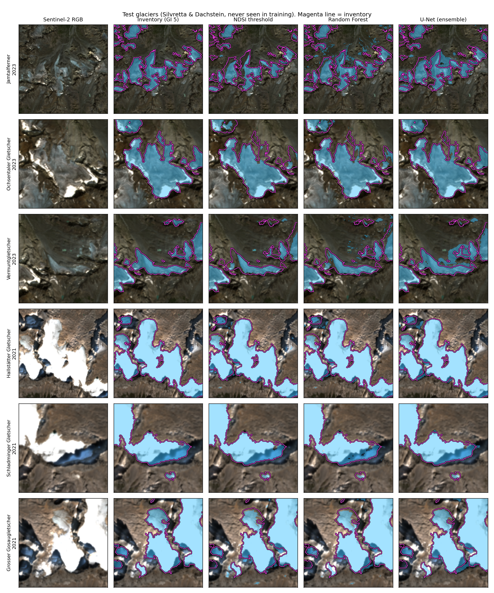
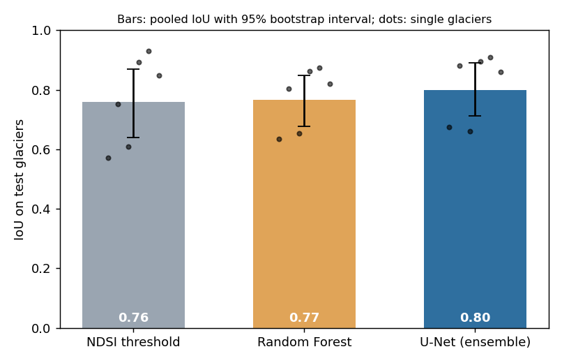
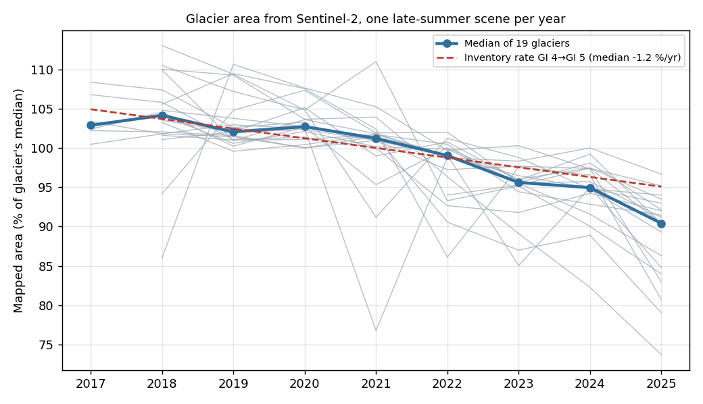
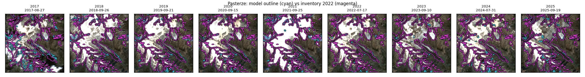
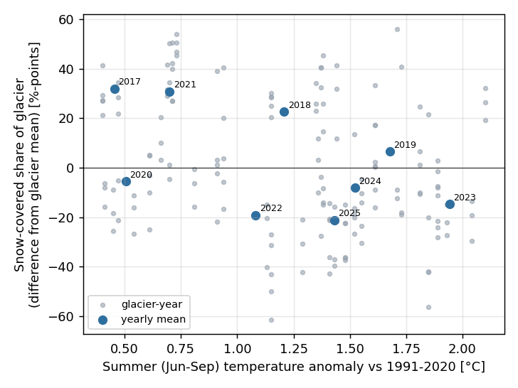

# Mapping Austrian Glaciers from Sentinel-2

A personal project on glacier mapping with satellite imagery and machine learning. I trained models to
outline glaciers in Sentinel-2 images, tested them on mountain ranges they had never seen, and then
used the best model to track 19 Austrian glaciers from 2017 to 2025.

**Three questions:**

1. How much better is a small U-Net than the classic NDSI threshold and a per-pixel Random Forest,
   on regions it was not trained on?
2. Does the area mapped by the model shrink at a rate similar to the official glacier inventory?
3. Is less snow left on the glaciers at the end of warmer summers?

Everything below is produced by `glacier-pipeline run` from open data. No numbers are typed in by hand.



---

## Data

| Source | What | Used for |
| --- | --- | --- |
| Sentinel-2 L2A (Element84 Earth Search STAC) | 6 bands (blue, green, red, NIR, SWIR1, SWIR2) + scene classification | model input; one late-summer scene per glacier per year |
| Copernicus DEM GLO-30 | elevation | elevation, slope, aspect, hillshade as extra inputs |
| Austrian Glacier Inventory GI 5 (2021-2023), PANGAEA | glacier outlines | labels |
| Austrian Glacier Inventory GI 4 (2015), PANGAEA | glacier outlines | time-series region; inventory shrinkage rate for comparison |
| GeoSphere Austria, monthly station data | air temperature | summer (Jun-Sep) temperature anomaly vs. 1991-2020 |
| geoBoundaries | Austrian border | the inventory covers only Austria, so pixels across the border are ignored |

**Processing:**
- Every glacier gets its own 20 m grid in UTM 32N. All rasters are warped onto it, so the image,
  the DEM and the label line up pixel by pixel.
- For each glacier and year, the code searches mid-July to mid-October. It picks the scene with
  the fewest cloud or no-data pixels over the glacier and the least seasonal snow away from glaciers.
- Labels are *all* GI 5 ice inside the grid, not just the target glacier, so a correctly found
  neighbouring glacier is not counted as an error.

**Study design:** 19 glaciers in 5 regions, split by region so the test set is truly unseen.

| Split | Regions | Glaciers |
| --- | --- | --- |
| Train | Ötztal, Hohe Tauern, Stubai | 8 |
| Validation (model selection, early stopping) | same regions, different glaciers | 5 |
| **Test** | **Silvretta, Dachstein** | **6** |

**Training data:** imagery from the GI 5 mapping year ±1 year, paired with the GI 5 outline, cut
into 64×64 tiles (1,650 tiles). Evaluation always uses the mapping year itself.

## Models

- **NDSI threshold**: the standard snow/ice index; the threshold (0.38) is tuned on training data.
- **Random Forest**: 150 trees on the 14 per-pixel features (bands, NDSI/NDWI/NDVI, terrain), with
  no spatial context.
- **Residual U-Net**: about 0.9 M parameters, trained from scratch with Dice + weighted
  cross-entropy, AdamW and early stopping on validation IoU. It's trained with 3 seeds, and their
  probabilities are averaged (ensemble).

---

## Results

### 1. Segmentation on unseen regions



| Model | Test IoU (pooled) | 95% CI (bootstrap over glaciers) | Boundary F1 | Median abs. area error |
| --- | --- | --- | --- | --- |
| NDSI threshold | 0.760 | 0.64 – 0.87 | 0.81 | 10.1 % |
| Random Forest | 0.766 | 0.68 – 0.85 | 0.82 | 11.5 % |
| **U-Net (3-seed ensemble)** | **0.800** | 0.71 – 0.89 | **0.85** | **5.3 %** |

- Single U-Net seeds reach 0.791 ± 0.012 test IoU. On the validation glaciers the U-Net reaches 0.871.
- The U-Net is best on every summary metric. With only 6 test glaciers, though, the intervals
  overlap. The gain is consistent, but this test set can't prove it's large.
- The drop from validation (0.87) to test (0.80) shows the domain shift to new mountain ranges.
- **Where it fails:** Jamtalferner and Vermuntgletscher (IoU ≈ 0.67). In the 2023 scene these
  glaciers are mostly dark, dirty bare ice with little snow. All three models miss parts of them,
  and the U-Net also over-extends onto nearby terrain at Vermuntgletscher.
  The Dachstein glaciers were snow-covered in the 2021 scene, which makes them easy for every model
  (IoU 0.86–0.91).

### 2. Glacier area 2017–2025



- The U-Net ensemble mapped every glacier in every year. A glacier-year is skipped when more than 3% of
  the glacier is under cloud. That happened 14 times out of 171, mostly in 2017, when few clean
  Sentinel-2 L2A scenes exist.
- **Median trend: −1.9 % per year** (Theil–Sen). The decline is significant (Mann–Kendall p < 0.05)
  for 16 of 19 glaciers.
- **Inventory comparison:** the GI 4 (2015) → GI 5 (2021–23) change works out to a median of
  **−1.2 % per year**.
- So the model shows somewhat faster shrinkage. Two reasons are likely, and this data can't
  separate them:
  1. The periods differ: 2022 and 2025 were extreme melt years and fall only in the satellite period.
  2. Leftover snow in early years makes glaciers look larger, which steepens the trend.
- Single years can jump by 10–20 % (see the grey lines) when a scene has fresh or leftover snow.
  This is the main limitation of using one scene per year.

Example: Pasterze, every year, model outline (cyan) vs. GI 5 2022 (magenta):



### 3. Snow left at the end of summer vs. summer temperature



**Method:**
- For each glacier-year I measured the share of the glacier covered by bright snow (visible
  reflectance > 0.5 and NDSI > 0.4).
- I regressed it on the regional summer temperature anomaly, with glacier fixed effects and the
  scene's day of year as a control. The day-of-year control matters because a September image
  shows less snow than a July one.

**Result:**
- **Each +1 °C of summer anomaly goes with about 17 percentage points less snow on the glacier**
  (SE 4 pp, n = 157 glacier-years).
- Caveat: glaciers in the same summer aren't independent, so the regression p-value (0.0002)
  overstates the certainty.
- Using only the 9 yearly means, the correlation is r = −0.52 (p = 0.15): the right direction, but
  not significant with 9 points.

---

## Limitations

- **Accuracy is only measured in the inventory year.** IoU and area error are computed for each
  glacier's GI 5 year (2021–2023). For the other years the model is applied without a reference,
  so the 2017–2025 areas assume the model works as well in those years as in the inventory year.
- **One scene per year.** Leftover or fresh snow is the main source of noise. A multi-scene
  minimum-snow composite would be the next step.
- **Labels from a single inventory date.** Training uses mapping year ±1 with the same outline, and
  glaciers change by roughly 1–2 % per year in that time.
- **Small test set** (6 glaciers in 2 regions), so the confidence intervals are wide.
- **20 m resolution.** Small glaciers (< 1 km²) are only a few hundred pixels.
- **Inventory matching.** Vermuntgletscher appears to *grow* between GI 4 and GI 5, which is
  probably a mapping-method difference rather than real growth. Hintereisferner has no GI 4 match
  by ID, so its region uses the GI 5 outline.
- **Not bit-reproducible on GPU.** On Apple-silicon GPUs (MPS), PyTorch is not fully deterministic,
  so results can differ in the last digits between machines.

---

## Run it

```bash
pip install -e ".[dev,app]"

glacier-pipeline download   # ~100 MB of imagery, cached in data/ (resumable)
glacier-pipeline run        # train, evaluate, time series, figures -> reports/
pytest                      # unit tests (no download needed)
streamlit run app/streamlit_app.py   # project website (works right away: its data is in the repo)
```

Training takes a few minutes on an Apple-silicon GPU or a CUDA GPU, and much longer on CPU.

## Repository structure

```text
configs/default.yaml            years, grid size, training settings
src/glacier_monitoring/
  data/ingest.py                downloads: STAC scenes, DEM, inventories, climate, border
  data/features.py              14 input channels (bands, indices, terrain)
  data/dataset.py               glacier objects, splits, tiles, normalisation (train stats only)
  models/baselines.py           NDSI threshold, Random Forest
  models/cnn.py                 residual U-Net
  training/                     training loop, losses
  evaluation/metrics.py         IoU, F1, boundary F1, area error, glacier bootstrap
  timeseries/                   Theil–Sen / Mann–Kendall trends, snow vs. temperature
  visualization/plots.py        all figures
  pipeline.py                   runs everything end to end
app/                            project website (Streamlit): introduction + interactive explorer
reports/                        tables (CSV), figures, summary.json
tests/                          unit tests (leakage checks, metrics, models, trends)
```

## Data credits

- Sentinel-2: contains modified Copernicus Sentinel data, via Element84 Earth Search.
- Copernicus DEM GLO-30: © DLR e.V. 2010–2014 and © Airbus Defence and Space GmbH 2014–2018,
  provided under COPERNICUS by the European Union and ESA.
- Glacier inventories: Buckel & Otto (2018), doi:10.1594/PANGAEA.887415, and Helfricht et al.,
  doi:10.1594/PANGAEA.991106.
- GeoSphere Austria data hub, station data `klima-v2-1m`.
- Austrian border: geoBoundaries (CC BY-SA 2.0, source: BEV).
